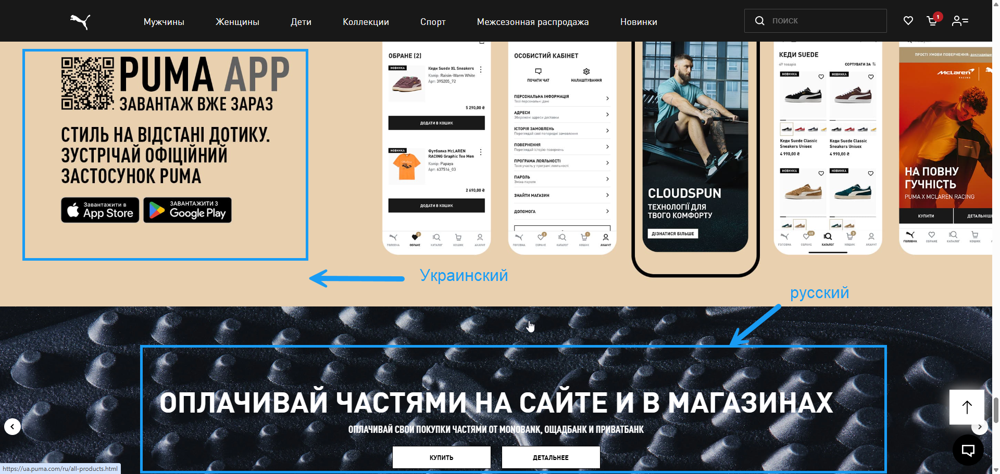
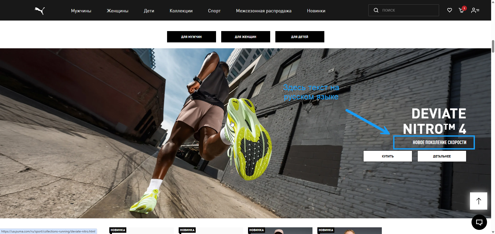
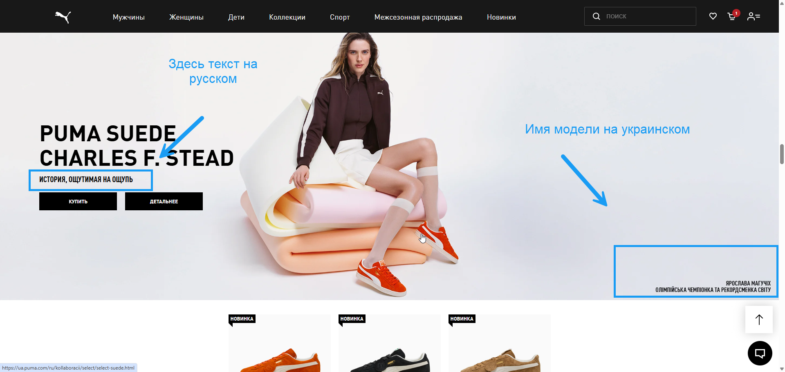

# Частина банерів головної сторінки залишається українською після перемикання мови сайту на російську

**Проєкт:** PUMA  
**ID у Jira:** QA-4  
**Тип тестування:** Функціональне тестування, локалізація  
**Серйозність:** Major  
**Пріоритет:** High  

## Оточення

- ОС: Windows 11 Pro 25H2
- Браузер: Google Chrome 147.0.7727.102 (64 bit)

## Кроки відтворення

1. Відкрити головну сторінку сайту PUMA
2. Прокрутити сторінку донизу
3. Натиснути кнопку вибору мови «Українська»
4. На сторінці вибору мови обрати російську мову
5. Переглянути банери на головній сторінці

## Очікуваний результат

Текстовий контент банерів відображається російською мовою відповідно до вибраної мови сайту

## Фактичний результат

Після перемикання мови сайту на російську частина банерів продовжує відображатися українською мовою, тоді як інші банери відображаються російською

## Докази

### Скріншот 1

### Скріншот 2

### Скріншот 3

