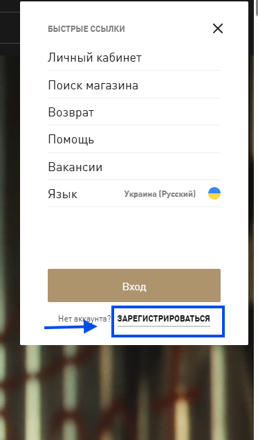
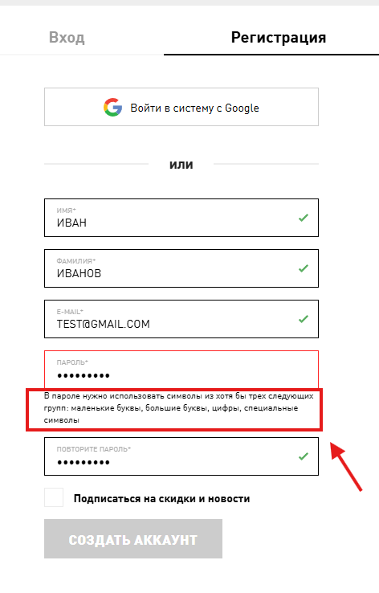

# Повідомлення про помилку не пояснює причину відхилення пароля з кириличними символами

**Проєкт:** PUMA  
**ID у Jira:** QA-5  
**Тип тестування:** Функціональне тестування, валідація форми  
**Серйозність:** Minor  
**Пріоритет:** Medium  

## Оточення

- ОС: Windows 11 Pro 25H2
- Браузер: Google Chrome 147.0.7727.102 (64 bit)

## Кроки відтворення

1. Відкрити офіційний сайт PUMA.
2. Відкрити меню швидких посилань.
3. Натиснути «Зареєструватися».
4. Заповнити поля імені, прізвища та електронної пошти коректними даними.
5. У полі пароля ввести пароль, який містить кириличні літери, цифри та спеціальний символ.
6. Перевірити повідомлення про помилку під полем пароля.

## Очікуваний результат

Якщо кириличні символи не підтримуються, система повинна повідомити про це користувача та надати зрозуміле пояснення вимог до пароля.

## Фактичний результат

Система відхиляє пароль із кириличними символами, але повідомлення про помилку не пояснює, що кирилиця може бути недопустимою. Через це користувач не може визначити причину відхилення пароля.

## Тестові дані

- Ім'я: ИВАН
- Прізвище: ИВАНОВ
- E-mail: test@gmail.com
- Пароль: [тестове значення не публікується]

## Докази
### Скріншот 1

### Скріншот 2

### Скріншот 3

