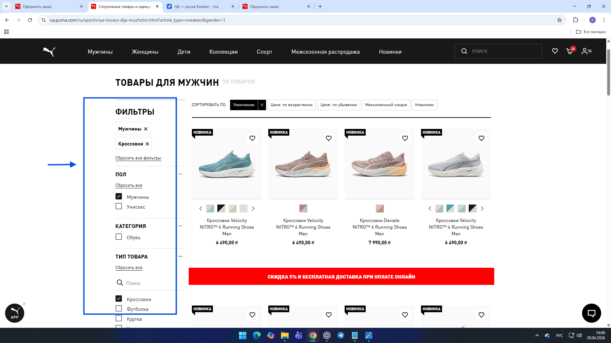
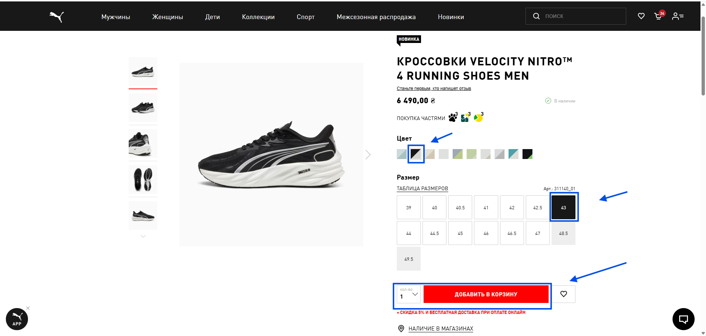
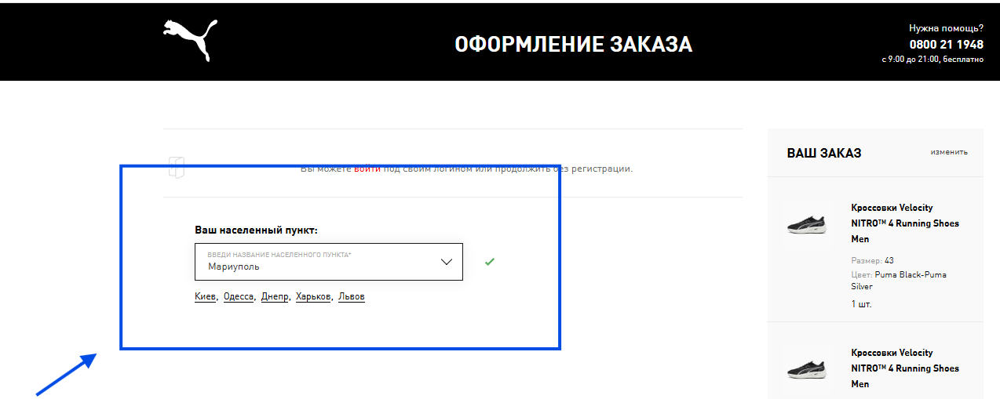

# Форма оформлення замовлення зникає після вибору населеного пункту «Маріуполь»

**Проєкт:** PUMA  
**ID у Jira:** QA-6  
**Тип тестування:** Функціональне тестування, оформлення замовлення  
**Серйозність:** Major  
**Пріоритет:** High  

## Оточення

- ОС: Windows 11 Pro 25H2
- Браузер: Google Chrome 147.0.7727.102 (64 bit)

## Кроки відтворення

1. Відкрити сайт PUMA
2. Перейти до категорії чоловічого взуття
3. Вибрати товар, доступний для замовлення, та додати його до кошика
4. Перейти до кошика й натиснути «Оформити замовлення»
5. У полі «Ваш населений пункт» вибрати «Маріуполь»
6. Перевірити стан форми оформлення замовлення

## Очікуваний результат

Якщо доставка до вибраного населеного пункту недоступна, система повідомляє користувача про це та пояснює подальші дії

## Фактичний результат

Після вибору населеного пункту «Маріуполь» поля форми оформлення замовлення зникають. Повідомлення про недоступність доставки або пояснення подальших дій не відображається

## Докази
### Скріншот 1

### Скріншот 2

### Скріншот 3

### Скріншот 4

